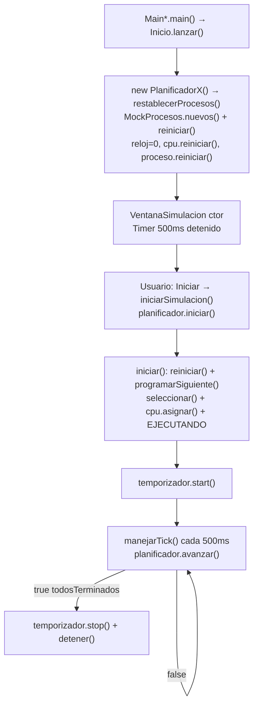
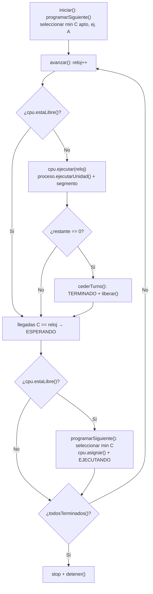
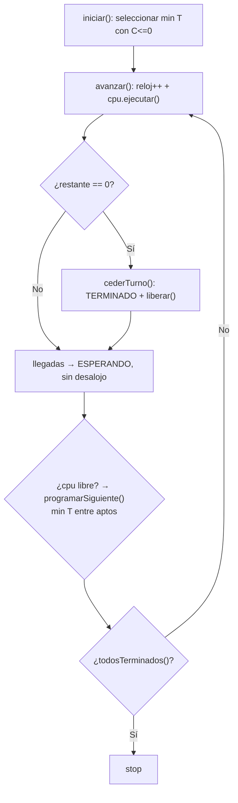
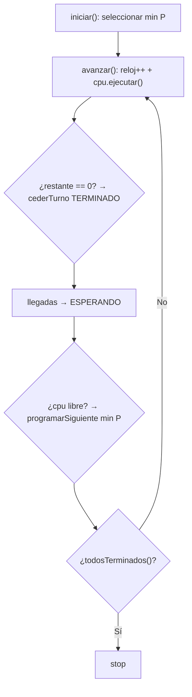
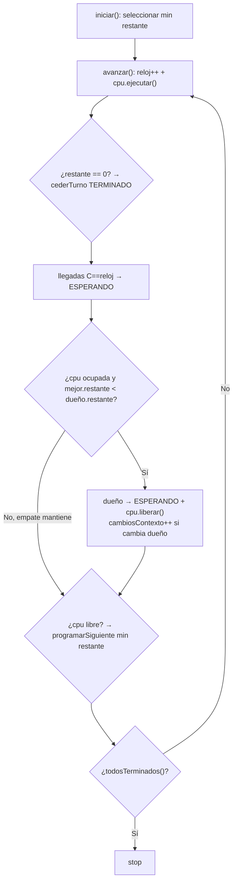
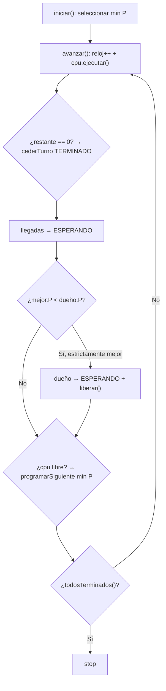
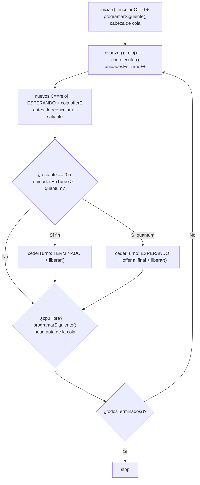

# Flujo UML de los algoritmos de planificación

> Base: `README.md §1.2`, `motor/Planificador.java`, `motor/CPU.java`, `modelo/Proceso.java`.
> Mock común: `A(0,5) B(3,2) C(1,3) D(2,2) E(4,4)` en `mock/MockProcesos.java`.

## 1. Arquitectura común

```mermaid
classDiagram
    class MainFIFO {
        +main()
    }
    class Inicio {
        +lanzar(fabrica)$
    }
    class VentanaSimulacion {
        -planificador : Planificador
        -temporizador : Timer
        +iniciarSimulacion()
        +manejarTick()
        +actualizarTodo()
    }
    class Planificador {
        <<interface>>
        +iniciar()
        +avanzar() bool
        +pausar() +continuar() +detener()
        +restablecerProcesos()
    }
    class PlanificadorFIFO
    class PlanificadorSJF
    class PlanificadorPrioridades
    class PlanificadorSRTF
    class PlanificadorRoundRobin
    class PlanificadorPrioridadesApropiativo
    class CPU {
        -dueno : Proceso
        +asignar() +liberar() +estaLibre()
        +ejecutar(reloj)
    }
    class Proceso {
        +ejecutarUnidad()
        +reiniciar()
        +getTiempoRestante() +getLlegada() +getRafaga() +getPrioridad()
    }
    MainFIFO --> Inicio : lanzar(VentanaFIFO::new)
    Inicio --> VentanaSimulacion : fabrica.get()
    VentanaSimulacion --> Planificador : iniciar() / avanzar()
    Planificador <|.. PlanificadorFIFO
    Planificador <|.. PlanificadorSJF
    Planificador <|.. PlanificadorPrioridades
    Planificador <|.. PlanificadorSRTF
    Planificador <|.. PlanificadorRoundRobin
    Planificador <|.. PlanificadorPrioridadesApropiativo
    PlanificadorFIFO --> CPU : asignar/liberar/ejecutar
    PlanificadorSJF --> CPU
    PlanificadorPrioridades --> CPU
    PlanificadorSRTF --> CPU
    PlanificadorRoundRobin --> CPU
    PlanificadorPrioridadesApropiativo --> CPU
    CPU --> Proceso : ejecutarUnidad()
```

## 2. Ciclo común `Main` → `Tick` (vale para los 6)



`iniciar()` es una sola vez por corrida (`if(ejecutando) return`). El bucle es `avanzar()`.

## 3. FIFO — no apropiativo, menor `C`

Criterio `seleccionar()`: `min(C) → id`. `cederTurno()`: solo si `restante==0` → `TERMINADO + tiempoFinalizacion=reloj + cpu.liberar()`.



## 4. SJF — no apropiativo, menor `T`

Igual que FIFO pero `seleccionar()`: `min(T) → C → id`. Solo despacha cuando la CPU queda libre; un corto que llega a mitad de ráfaga espera.



## 5. Prioridades (no apropiativo) — menor `P`

`seleccionar()`: `min(P) → T → C → id`. `cederTurno()` igual que FIFO/SJF. Llegada con mejor `P` no interrumpe.



## 6. SRTF — apropiativo, menor restante

`seleccionar()`: `min(tiempoRestante) → C → id`. `cederTurno()`: `restante==0 → TERMINADO`, si no → `ESPERANDO` (interrumpido).



## 7. Prioridades apropiativo — menor `P` con desalojo

Igual selección que Prioridades, pero decisión extra por tick: `mejor.P < dueño.P` desaloja. Igual `P` no desaloja.



## 8. Round Robin — cola circular + quantum `Q=2`

Estructura propia `Queue<Proceso> cola` + `unidadesEnTurno`. `iniciar()` encola los de `C==0`. `cederTurno()`: `restante==0 → TERMINADO`, si no → `ESPERANDO + cola.offer()`.



## 9. Tabla de decisiones por método

| Método | FIFO | SJF | Prioridades | SRTF | Prioridades-Aprop. | Round Robin |
|---|---|---|---|---|---|---|
| `seleccionar()` | `min C` | `min T` | `min P` | `min restante` | `min P` | cabeza de `cola` apta |
| `esApto()` | `restante>0 && !TERMINADO && C<=reloj` | igual | igual | igual | igual | igual + está en cola |
| `cederTurno()` | solo al terminar | solo al terminar | solo al terminar | terminar o `ESPERANDO` si desalojado | terminar o `ESPERANDO` si desalojado | terminar o reencolar por quantum |
| Desalojo en `avanzar()` | no | no | no | `mejor.restante < dueño.restante` | `mejor.P < dueño.P` | `unidadesEnTurno >= quantum` |
| `programarSiguiente()` | si `cpu libre` | si `cpu libre` | si `cpu libre` | si `cpu libre` (tras posible desalojo) | si `cpu libre` (tras posible desalojo) | si `cpu libre`, `poll` apto |
